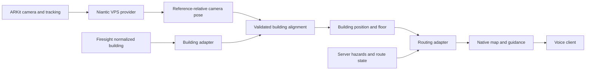

# Firesight native app architecture and integration plan

Status: integration proposal, November 7, 2026. This commit adds documentation only. Native implementation described below currently exists in a separate workspace and has not been merged into this repository. Repository inspection baseline: `bfeb608` on `main`. Existing behavior was inspected in `backend/server.py`, `backend/core/model.py`, `backend/services/occupants.py`, `docs/API.md`, and the viewer. No backend or app behavior changes are included in this document.

## Goal and scope

Build a native SwiftUI client that knows its position in the building through Niantic VPS, displays the correct floor and route, and integrates with Firesight's building, hazard, routing and voice services. Keep the ARKit session used by the Niantic SDK. Remove the obsolete standalone AR mapping experiment from the native product UI.

The native app has three primary workspaces:

1. **Localize:** import Site configuration, enter a local development credential, start VPS, inspect tracking, and export diagnostics. Camera imagery/sensor data is sent to Niantic only when live localization is started.
2. **Building:** import/inspect the building asset, pair landmarks, calibrate its coordinates against the VPS reference, and validate independent physical checkpoints.
3. **Navigate:** choose a supported destination or evacuation mode, show current floor/position and route, track progression, and consume guidance/voice updates.

Localize and Building are setup/diagnostic tools. Normal navigation should reuse their configured state. A floor-map interface is sufficient for the first integration; camera-view route arrows are optional presentation work.

This remains a research/demo prototype. Simulated fire, simulated localization and physically observed results must stay distinguishable.

## What already exists

| Component | Current implementation | Merge decision |
|---|---|---|
| Building extraction and normalization | `backend/mapping/`, `backend/core/model.py`, `data/buildings/` | Reuse. Treat the normalized building as the integration input. |
| Walkability, fire and routing | `backend/core/grid.py`, `fire.py`, `routing.py` | Reuse. Server remains authoritative for hazard-aware evacuation routes. |
| Phone-facing APIs | `backend/services/occupants.py`, `docs/API.md` | Consume documented responses through native adapters. |
| Voice | `backend/services/voice.py`, `viewer/voice-agent.js`, `docs/FISH_AGENT.md` | Reuse server voice services; native audio playback/client-tool wiring is still to be integrated. |
| Existing web localization | `backend/services/localize.py`, `viewer/pdr.js` | Keep for web clients. Native VPS does not need to feed its camera into this separate particle filter. |
| Native localization | Separate iOS project: `Services/Localization/`, `Views/Localization/` | Merge native Swift NSDK provider, configuration, diagnostics and simulation. |
| Native building/alignment | Separate iOS project: `Services/Building/`, `Views/Building/` | Merge import, calibration and pose transformation; add a repository-building adapter. |
| Native guidance | Separate iOS project: `Services/Navigation/`, `Views/Navigation/` | Merge route display/progress. Retain local graph planner for explicit ordinary-navigation/demo use, not as a silent replacement for server evacuation routing. |

The separate native build currently links NSDK at commit `7b22900f8d38d732262897debc43986bda65c7aa`, targets iOS 17+, and has passed unsigned generic-iOS compilation and synthetic domain/integration checks. Those checks have not validated this repository's API integration or a real Niantic Site.

## Proposed repository structure

Keep the existing backend and viewer paths. Add the native project without renaming its Xcode target during the initial merge:

```text
ios/ARKitLocalizationTest/
  ARKitLocalizationTest.xcodeproj/    source membership, pinned SPM dependency
  App/                              composition root, lifecycle, permissions
  Models/SpatialContracts.swift     shared native data/coordinate contracts
  Services/
    Localization/                   Niantic provider, replay, token/config store
    Building/                       asset import, calibration, pose conversion
    Navigation/                     route planning/progress and guidance state
    Integration/                    NEW: backend API and schema adapters
    DiagnosticRecorder.swift        serialized, bounded diagnostic history
  Views/
    Localization/
    Building/
    Navigation/
  Fixtures/                         synthetic model, graph, calibration, poses
  Tests/                            standalone tests, outside app source phase
  Scripts/                          repeatable checks
  Docs/                             native setup and schema/runbooks
docs/FIRESIGHT_APP_ARCHITECTURE.md    this merge contract
backend/                            existing service owners retain ownership
viewer/                             existing web-client owners retain ownership
```

`Services/Integration/` is proposed work, not code already present. Suggested adapters: `FiresightAPIClient`, `FiresightBuildingAdapter`, `FiresightRouteAdapter`, and `FiresightVoiceClient`. Keep network DTOs separate from native domain types so backend JSON changes do not propagate into NSDK code.

## Runtime data flow



NSDK classes stop at the localization boundary. Building and navigation code consume plain timestamped poses and declared identities. One app-level coordinator owns camera/session lifecycle and shared state. Do not start a second AVCaptureSession for navigation or obstacle inference.

## Coordinate contract: the first required merge

The repository and native project currently use different schemas:

- Backend plan coordinates: meters, `(x,y)`, origin at the shared plan footprint, x right and y down. Floor `alignment` transforms have already been applied in `GET /api/building`.
- Native canonical coordinates: meters, right-handed +Y up, horizontal `(X,Z)`; camera forward is -Z. Matrices are column-major and named `destinationFromSource`.

Proposed adapter mapping:

```text
native X = normalized backend x
native Z = normalized backend y
native Y = verified physical elevation of the resolved floor
backend request = { level: explicit floor-level mapping, x: native X, y: native Z }
```

Do not confuse backend `y` with native vertical Y. Do not apply per-floor alignment twice. `level` is a floor identifier, not an array index or camera-height reading. Use a declared floor-ID/level/elevation table. `floor_height_m` can initialize that table, but verify it physically; raw camera Y includes handheld height.

The viewer's floor spacing slider is presentation-only. Its current default gap is 9 m; the DCC source declares `floor_height_m: 4.0`. Never calibrate VPS to the exploded viewer spacing or derive physical elevations from that slider.

For the tracked reference frame:

```text
referenceFromCamera = inverse(sessionFromReference) * sessionFromCamera
buildingFromCamera = buildingFromReference * referenceFromCamera
```

If exported mesh coordinates differ from the tracked-anchor origin, preserve and compose the mesh-to-reference transform. File conversion and model registration are separate steps. Test with asymmetric landmarks, a known length and withheld checkpoints; a visually plausible overlay is insufficient.

For backend plan headings, `atan2(forwardX, -forwardZ)` gives clockwise degrees from plan-up after normalization. Apply `plan_north_deg` only when converting to compass coordinates. Camera facing is not walking direction; route-relative guidance is the default.

## Shared identities and interfaces

The native contracts already define:

- `LocalizationConfiguration`: Site ID, selected asset/version identity, reference-frame ID and anchor payload. Credentials are separate in Keychain.
- `LocalizationSample`: full optional reference-from-camera pose, anchor tracking state, provider epoch/sequence, monotonic timestamp and simulated/live provenance.
- `BuildingPackage`: building ID/revision, floor elevations/outlines, USDZ/model transform, landmarks, destinations and graph.
- `SiteAlignment`: building and Site/asset/reference identities, rigid transform, fitted/holdout landmarks and physical-check status.
- `BuildingPose`: aligned position, camera-forward vector, floor resolution, eligibility, timing, epoch and provenance.

Backend `GET /api/building` is not already a native BuildingPackage. Implement an adapter or export process; do not rename a DCC JSON file and expect native import to work. Add stable building/revision identifiers or pin a canonical normalized-building content hash. Preserve explicit room, door, floor and destination mappings.

`/api/rev` currently represents world/routing state (`world id:t`). It is not a persistent building-content or Niantic asset-version identifier. Keep structural revision and hazard/route revision separate. Imported portal asset identity is configuration, not automatic proof of the server's active asset version.

## Backend integration boundaries

| API | Native use | Current limit / required work |
|---|---|---|
| `GET /api/building` | Load normalized geometry, room/door IDs, floor metadata | Add native schema conversion and stable content identity; verify model export/units. |
| `GET /api/nav?level=&x=&y=` | Evacuation path and turn/hazard hints | Current endpoint routes to an exit. It has no arbitrary destination parameter. |
| `GET /api/rev` and `/api/state` | Detect route/hazard changes | Refetch relevant data; discard out-of-order responses. Verify invalidation for every hazard/report mutation, not only simulation steps. |
| `GET /api/voice/tts?text=&style=` | Obtain audio for a validated cue | Native audio queue/playback and cancellation still need integration. Keys stay server-side. |
| `/api/people/{id}/status` | Explicit user check-in | Send only on deliberate action with the associated position validity. |
| `/api/loc/*` | Existing web particle-filter path | Do not silently replace a VPS fix with this separate estimate. Any future fusion needs a separate contract. |

Important existing behavior: unreachable `/api/nav` responses can still contain `turn: "arrive"`. Native guidance must first check `reachable`, valid path/target, current localization and actual arrival conditions. It must never announce arrival from `turn` alone. The existing route API can snap a start up to 3 m to a passable cell; validate association so this cannot hide a wrong-room/wrong-side-of-wall pose.

Two routing modes must remain explicit:

1. **Evacuation:** server hazard-aware exit routing is authoritative. Reject unreachable/stale data; do not fall back silently to the static local planner. Existing evacuation policy excludes elevators.
2. **Ordinary destination navigation/demo:** the native graph planner can target door entrances. A backend destination-routing endpoint is future work and must be added/documented/tested before claiming server support. Accessible elevator routing in a non-emergency demo does not override evacuation policy.

## Assets and configuration handoff

The mapping team supplies normalized building data, measured floor elevations, room/door IDs, a renderable USDZ or convertible mesh, and route semantics. The localization team supplies an accessible New Scaniverse Production VPS Site/anchor and correct reference metadata. Classic local Scaniverse exports alone cannot initialize the current NSDK workflow.

Preserve originals and source hashes. Convert GLB/FBX to USDZ offline when necessary, retaining effective node transforms, units and axes. Retain a documented model-to-building transform. A splat is optional visualization, not a traversability graph. Calibrate shared structural landmarks and independent holdouts before enabling live directions.

Tokens, service-account keys and backend API keys never go into building packages, source commits or reports. Configure the backend base URL externally; an iPhone's localhost is not the development laptop. Use the team's HTTPS endpoint for network integration.

## Three-agent ownership and merge order

| Owner | Vertical slice | Exclusive paths |
|---|---|---|
| Agent 1 | Configure Site → localize → inspect/export pose | Native `Services/Localization`, `Views/Localization`, matching fixtures/tests/docs |
| Agent 2 | Import building → adapt schema → calibrate → inspect position | Native `Services/Building`, `Views/Building`, building fixtures/tests/docs; coordinate backend exporter changes with its owner |
| Agent 3 | Choose route mode/target → request/compute path → guide/replan/voice | Native `Services/Navigation`, `Views/Navigation`, routing fixtures/tests/docs; coordinate API/voice adapters with existing service owners |
| Integration lead | Contracts, lifecycle, app composition, dependency/project membership | Shared models, `App`, Xcode project, shared recorder, integration DTOs and documentation |

Only the integration lead edits shared interfaces and project membership. Agree adapter contracts before parallel backend/client edits. Use small branches/PRs; do not copy an entire prototype over this repository's backend or viewer.

Merge sequence:

1. Merge this document; freeze coordinate, floor-ID, revision and route-mode contracts.
2. Bring in the native project at `ios/ARKitLocalizationTest`, including pinned NSDK, setup docs and simulated tests. Preserve signing identity rather than mass-renaming the target during integration.
3. Remove legacy AR Test, ARWorldMap save/load, manual wall placement, old map exporter, vendor-comparison and unrelated room-recognition screens from the native product. Keep necessary ARKit tracking, reference-mesh diagnostics, calibration, report sharing and simulation.
4. Add backend building/route adapters and contract fixtures. Establish one canonical building frame and verify a known point both ways.
5. Integrate server evacuation routing, revision handling and voice. Keep static local demos labeled and separate.
6. Connect the real Niantic asset, calibrate and test physical routes. Record results separately from build/simulation checks.

## Acceptance before calling the parts merged

- Native device-target build links and embeds the pinned SDK; app source/resource membership is valid. Existing backend/web tests still pass.
- One camera owner, clean stop/background behavior, and no obsolete AR Test product entry point.
- DCC normalized building converts with correct units, already-applied floor alignment, explicit IDs and physical elevations; display floor spacing does not affect localization.
- Site/asset/reference and building/calibration revisions match before any pose becomes navigation-eligible.
- Synthetic end-to-end replay covers pose → alignment → floor → route → stable progression/arrival, including lost/stale/out-of-order poses and large corrections.
- API contract tests cover unreachable `turn: arrive`, wrong floors, stale route responses, hazard updates and server failure without unsafe static fallback.
- Ordinary room targets and evacuation exits are distinct and use their declared routing policy.
- Voice cancels obsolete directions on reroute/loss, and backend failures do not produce invented instructions.
- Real Site tests cover two destinations, return visits, withheld calibration checkpoints and tracking loss. No physical accuracy or safety claim follows from compilation or restored tracking alone.

## Immediate next work

The native readiness implementation exists separately with software tests passing. Backend/network adapters, arbitrary-destination server routing, native audio playback and legacy removal are not claimed complete. The cleanup agents were paused at the user's request so this integration document can be committed before further implementation. Resume against this repository-aware contract after the team agrees on ownership and routing mode.
