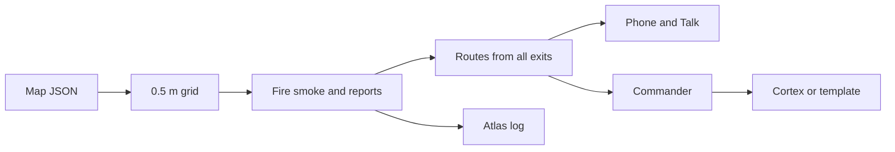

# Firesight

Wayfinding apps assume the building is safe. Firesight assumes it isn't.

Firesight turns floor plans into a multi-floor 3D map, runs a mock fire, and gives every person a live escape route. A phone opened from a room QR shows the way out on the camera, with a mini-map and voice. The same server drives the laptop viewer, so a new fire updates every route at once.

HackRPI 2026.

## What it does

- Floor plan PDF to a 3D multi-floor map.
- Fire and smoke simulation on that map.
- Live rerouting for everyone when hazards change.
- Phone app via QR: camera arrow, mini-map, Fish Audio voice.
- Fish Audio voice agent on the phone. Tap Talk. The agent calls client tools for place, route, hazards, and check-in. Setup is in [docs/FISH_AGENT.md](docs/FISH_AGENT.md).
- Indoor positioning from phone motion sensors, a particle filter, and OCR of room numbers.
- Firefighter voice or text reports. Speech becomes map updates, routes change, and Fish Audio reads the line back. Undo restores the last report.
- Commander dashboard at `/command.html`: Cortex briefing and questions, people, timeline, field reports, and search progress. With no Cortex credentials the briefing is a fixed template.
- MongoDB Atlas incident log, and a stored version of each saved map.
- Map editor for walls, doors, labels, and exits.
- Gemini image extraction as an alternative input when you have pictures instead of vector PDFs.

## How it works

1. **Map.** A vector PDF (or Gemini, from images) becomes building JSON in meters. The loader aligns floors, drops bad geometry, and records warnings.
2. **Grid.** Floors become a 0.5 m grid. Walls block cells. Doors cut openings. Cells outside a floor outline stay blocked.
3. **Fire.** Fire spreads to walkable 4-neighbors with probability 0.30 per step. Smoke diffuses and rises through stairs. Replace the sim later by writing the fire and smoke arrays.
4. **Routing.** One multi-source Dijkstra from all exits builds a next-step field for every cell. Smoke multiplies step cost by `1 + 12 * smoke`. Stairs cost 8 m per floor. Elevators are excluded from evacuation routes. The field is rebuilt after every fire change.
5. **Phone.** A QR sets the start pose. The phone asks for the route from its position. Motion is tracked with 500 particles. OCR of a room number snaps the cloud toward that door. If the cloud spreads past 4 m, the pose is marked unsure. Talk starts the Fish voice agent. While it is on, the page's own voice stays quiet.
6. **Field reports.** Hold to talk on `/firefighter.html`, or type a line. Fish Audio speech-to-text feeds a parser. Rules name the rooms and stairs. Cortex fills a missing target when it is configured. The server paints fire, smoke, blocked cells, and searched rooms, then rebuilds routes. Fish Audio reads the confirmation back. Undo puts the last report back.
7. **Commander.** `/command.html` shows the floors, a briefing, a question box, people, a timeline, field reports, and search progress. The briefing comes from Snowflake Cortex. With no credentials, or if the call fails, a fixed template is used. Questions need Cortex. The model may use only the facts it is given. A missing fact stays Unknown. Simulated fire is labeled as simulated.
8. **History.** With `MONGODB_URI`, events and each saved map go to MongoDB Atlas. Without it, those writes are skipped.



## Quick start

Python 3.11 or newer. Run these from the repo root.

Windows PowerShell:

```powershell
python -m venv .venv
.\.venv\Scripts\Activate.ps1
pip install -r requirements.txt
python scripts/make_sample.py
$env:FIRESIGHT_BUILDING = "data/buildings/dcc.json"
uvicorn backend.server:app --reload --port 8000
```

macOS and Linux:

```bash
python3 -m venv .venv
source .venv/bin/activate
pip install -r requirements.txt
python scripts/make_sample.py
export FIRESIGHT_BUILDING=data/buildings/dcc.json
uvicorn backend.server:app --reload --port 8000
```

`scripts/make_sample.py` writes a synthetic 3-floor building to `data/buildings/sample_building.json`. That file is the default when `FIRESIGHT_BUILDING` is unset. The commands above load the DCC map instead.

Open:

- http://localhost:8000/ for the 3D viewer
- http://localhost:8000/editor.html for the map editor
- http://localhost:8000/phone.html?qr=F3-318 for the phone app in room F3-318
- http://localhost:8000/firefighter.html for field reports (hold to talk, type, undo)
- http://localhost:8000/command.html for the commander dashboard
- http://localhost:8000/pdr-test.html for the motion-sensor test page
- http://localhost:8000/api/qr/print for a printable sheet of room QR codes

The phone camera and compass need HTTPS. In another terminal:

```bash
cloudflared tunnel --url http://localhost:8000
```

Open the printed `https://` URL on the phone.

### Environment variables

| Name | Role |
|---|---|
| `FIRESIGHT_BUILDING` | Path to building JSON. Default `data/buildings/sample_building.json`. |
| `GEMINI_API_KEY` | Key for image extraction. The Gemini client reads it. |
| `GEMINI_MODEL` | Gemini model. Default `gemini-3.1-pro-preview`. |
| `FISH_API_KEY` | Required for speech synthesis and speech-to-text. A missing key returns HTTP 503. |
| `FISH_VOICE_ID` | Occupant voice model id from `fish.audio/m/<id>`. This is not the Talk agent id. Left off the request when unset. |
| `FISH_VOICE_ID_FF` | Firefighter voice model id, same form as `FISH_VOICE_ID`. Falls back to `FISH_VOICE_ID`. |
| `FISH_MODEL` | Fish Audio TTS model header. Default `s2.1-pro`. |
| `MONGODB_URI` | Atlas connection string. Unset: the event log and map versions are skipped, and `/api/history/*` except `/api/history/status` returns 503. |
| `MONGODB_DB` | Atlas database name. Default `firesight`. |
| `SNOWFLAKE_ACCOUNT` | Account identifier, such as `orgname-acct`. Required for Cortex. |
| `SNOWFLAKE_PAT` | Programmatic access token for Cortex. Never logged. |
| `SNOWFLAKE_MODEL` | Cortex model. Default `claude-sonnet-4-5`. |

`GEMINI_API_VERSION` defaults to `v1beta` for the image extractor.

## Rebuilding the map

Vector PDFs (lowest floor first):

```bash
python -m backend.mapping.pdf_extract data/plans/darrin-1.pdf data/plans/darrin-2.pdf data/plans/darrin-3.pdf -o data/buildings/dcc.json
```

Add `--debug data/debug` to write a PNG per floor.

Gemini, from images in floor order. Set `GEMINI_API_KEY` first.

```bash
python -m backend.mapping.extract_floorplans f1.png f2.png f3.png -o data/buildings/dcc-gemini.json --rounds 3
```

Each round is saved beside the output. The file with the fewest check issues is written to `-o`. To refine an existing JSON, add `--start data/buildings/dcc-gemini.json`.

Check a map:

```bash
python -m backend.core.checks data/buildings/dcc.json
```

Fix what remains by hand in the editor (`/editor.html`), then save. The editor writes `data/buildings/<name>.json` through `POST /api/building/save`.

## Repo structure

```
backend/core/            model load, 0.5 m grid, fire sim, routing, map checks
backend/mapping/         PDF extractor and Gemini image extractor
backend/mapping/prompts/ Gemini extract and fix prompts
backend/services/        QR, nav, Fish TTS and ASR, field reports, particle filter, OCR, Atlas, Cortex
backend/server.py        FastAPI app and static viewer
viewer/                  3D viewer, editor, phone, firefighter page, commander, PDR test
data/buildings/          building JSON the server loads
data/plans/              source floor plan PDFs
data/archive/            earlier map drafts
scripts/                 sample building generator
tests/                   five files: test_core, test_tier2, test_localize, test_reports, test_data
docs/                    API reference and Fish agent setup (docs/FISH_AGENT.md)
```

Optional files the server uses when present: `data/qr.json` (QR pose overrides) and `data/tts_cache/` (speech clips).

## Tests

From the repo root, with the venv active:

```bash
python tests/test_core.py
python tests/test_tier2.py
python tests/test_localize.py
python tests/test_reports.py
python tests/test_data.py
```

`test_core.py` covers routing, reroute on fire, validation, the API, and map checks. `test_tier2.py` covers QR, nav hints, check-ins, and voice. `test_localize.py` covers the particle filter, stairs, and room-number OCR. `test_reports.py` covers radio parsing, map updates, undo, and speech-to-text. `test_data.py` covers the Atlas log when Mongo is off, the template briefing, and Cortex questions.

## Honest limits

Fire and smoke are simulated. A production system would take readings from alarm panels and sensors.

Gemini maps need a person to review them. That review is done once, before any emergency.

Cameras fail in heavy smoke. A production system would also use IMU, Wi-Fi, BLE, or UWB.

If the position is unsure, the pose is flagged. A wrong room is worse than no room.

## Future work

- Sensor input in place of the cellular automaton.
- A floor path drawn with WebXR on Android Chrome.
- Image-retrieval localization from hallway walkthroughs.
- A hosted deploy. Atlas already stores the event log and each saved map. Check-ins stay in memory for the life of the process.

## Built with

Python, FastAPI, numpy, scipy, Three.js, PyMuPDF, OpenCV, RapidOCR, the Gemini API, Fish Audio (ASR, TTS, and voice agents), MongoDB Atlas, and Snowflake Cortex.

Built using Claude Code and Cursor with Grok agents. HackRPI 2026.

## Prize tracks

- Fish Audio: occupant TTS, firefighter speech-to-text and read-back, and the Talk voice agent.
- Gemini API: floor plan image extraction.
- MongoDB Atlas: incident event log and versioned maps.
- Snowflake API: commander brief and building questions through Cortex.
- SpaceXSI: built in Cursor with Grok agents.
- ML/Data Science: particle filter localization and room-number OCR.
- Ethical AI: briefings use only listed facts, a missing fact stays Unknown, an unsure pose is never guessed, and simulated fire is labeled as simulated.
